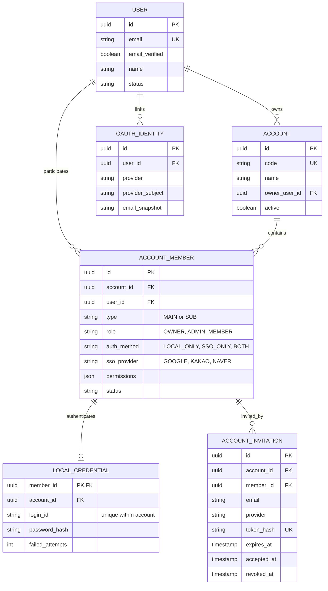

# 사용자·계정 인증 설계

## 설계 기준

화면 기획에는 고객의 홈, 업무, 제작제품, 공장·공급사, 예치금, 내 정보와 관리자 주문·예치금·설정·재무 기능이 포함되어 있다. 이 데이터들은 모두 고객사 단위로 분리해야 하므로 업무 테이블은 앞으로 `account_id`를 필수 외래키로 갖는다.

사용자와 고객사 계정을 분리한다. `User`는 사람의 신원이고 `Account`는 데이터 격리와 결제·예치금의 기준이 되는 고객사다. 메인/서브계정은 `AccountMember.type`으로 표현한다.

## ERD

`account_members_one_main_per_account`와 `account_members_one_main_per_user` 부분 유니크 인덱스로 고객사당 메인 1개와 사용자당 메인 소속 1개를 보장한다.

Redis의 `auth:session:{sessionId}`에는 사용자·계정·멤버십 식별자, 역할, 현재 Refresh Token 해시, 절대 만료시각을 저장한다. `auth:member-sessions:{memberId}`에는 멤버의 세션 ID 집합을 저장해 서브계정 비활성화 시 모든 세션을 폐기한다. 토큰 원문은 저장하지 않는다.

## 인증 흐름

### 자체 로그인

1. 메인은 이메일과 비밀번호만 받는다. 서브는 고객사 코드, 로그인 ID, 비밀번호를 받는다.
2. Argon2id로 비밀번호를 검증한다.
3. Access JWT 15분, Refresh JWT 7일을 발급한다.
4. Refresh Token 원문은 저장하지 않고 SHA-256 해시만 Redis에 저장한다.
5. 인증 API는 Access JWT 서명과 Redis 세션 존재 여부를 모두 확인한다.

### Refresh Token

1. HttpOnly 쿠키의 Refresh JWT 서명과 만료를 확인한다.
2. Redis 해시와 일치하는지 확인한다.
3. 새 Access/Refresh Token을 발급하고 Redis 해시를 원자적으로 교체한다.
4. 이미 사용한 Refresh Token이 들어오면 해당 세션을 폐기한다.

세션의 최대 수명은 로그인 시점부터 7일이다. 토큰을 갱신해도 절대 만료시각은 늘어나지 않는다.

### Google·카카오·네이버 OAuth

1. 로그인 시작 API가 흐름 종류, 제공자와 필요한 계정 문맥을 Redis에 10분짜리 일회용 `state`로 저장한다.
2. 제공자 콜백에서 `state`를 1회 소비하고 authorization code를 제공자 토큰으로 교환한다.
3. 제공자 고유 ID를 `OAuthIdentity`로 조회한다.
4. 메인 SSO 로그인은 코드 없이 유일한 메인 멤버십을 찾고, 서브 SSO 로그인은 `accountCode`로 고객사 소속을 확정한다.
5. 신규 메인 SSO 가입은 원하는 고객사 코드를 먼저 받고 계정과 메인 멤버십을 생성한다.
6. SSO 전용 서브계정은 초대 토큰, 지정 제공자, 검증된 이메일이 모두 일치해야 활성화한다.
7. 같은 이메일이라는 이유만으로 기존 계정에 OAuth를 자동 연결하지 않는다. 로그인한 사용자가 연결 API를 호출해야 한다.
8. BEN Access/Refresh JWT를 발급하고 토큰 값을 URL에 노출하지 않은 채 프런트 콜백으로 이동한다.

## API

| Method | Path | Purpose |
|---|---|---|
| POST | `/api/auth/main/register` | 자체 로그인 메인계정과 고객사 생성 (`accountCode` 포함) |
| POST | `/api/auth/main/login` | 메인 자체 로그인 (이메일 + 비밀번호) |
| POST | `/api/auth/sub/login` | 서브 자체 로그인 (고객사 코드 + 로그인 ID + 비밀번호) |
| POST | `/api/auth/refresh` | JWT 회전 |
| POST | `/api/auth/logout` | Redis 세션 폐기 |
| GET | `/api/auth/me` | 현재 사용자·계정·권한 조회 |
| POST | `/api/auth/main/oauth/{provider}/register` | 메인 SSO 가입 URL 생성 |
| GET | `/api/auth/main/oauth/{provider}/start` | 메인 SSO 로그인 시작 |
| GET | `/api/auth/sub/oauth/{provider}/start?accountCode=ben` | 서브 SSO 로그인 시작 |
| GET | `/api/auth/oauth/{provider}/link/start` | 로그인 중인 계정에 SSO 연결 |
| GET | `/api/auth/invitations/{token}/oauth/{provider}/start` | SSO 전용 서브 초대 수락 |
| GET | `/api/auth/oauth/{provider}/callback` | OAuth 콜백 |
| GET | `/api/accounts/sub-users` | 서브계정 목록 |
| POST | `/api/accounts/sub-users` | 서브계정 생성 및 필요 시 초대 URL 반환 |
| PATCH | `/api/accounts/sub-users/{memberId}` | 서브 역할·권한·상태 수정 |
| DELETE | `/api/accounts/sub-users/{memberId}` | 서브 비활성화 및 세션 폐기 |

기존 `/api/auth/register`, `/api/auth/login`, `/api/auth/oauth/{provider}/start`는 호환용으로 유지한다.

## 다음 도메인 연결 규칙

- 주문, 공장·공급사, 제작제품, 예치금, 재무 테이블에는 `account_id`를 둔다.
- 모든 조회와 변경 조건에 인증 컨텍스트의 `accountId`를 포함한다.
- 예치금 승인과 재무 기능은 문자열 권한(예: `deposit.approve`, `finance.read`)을 `AccountMember.permissions`에서 검사한다.
- 관리자 어드민 사용자는 고객사 멤버십과 분리된 별도 운영자 모델로 확장한다.
